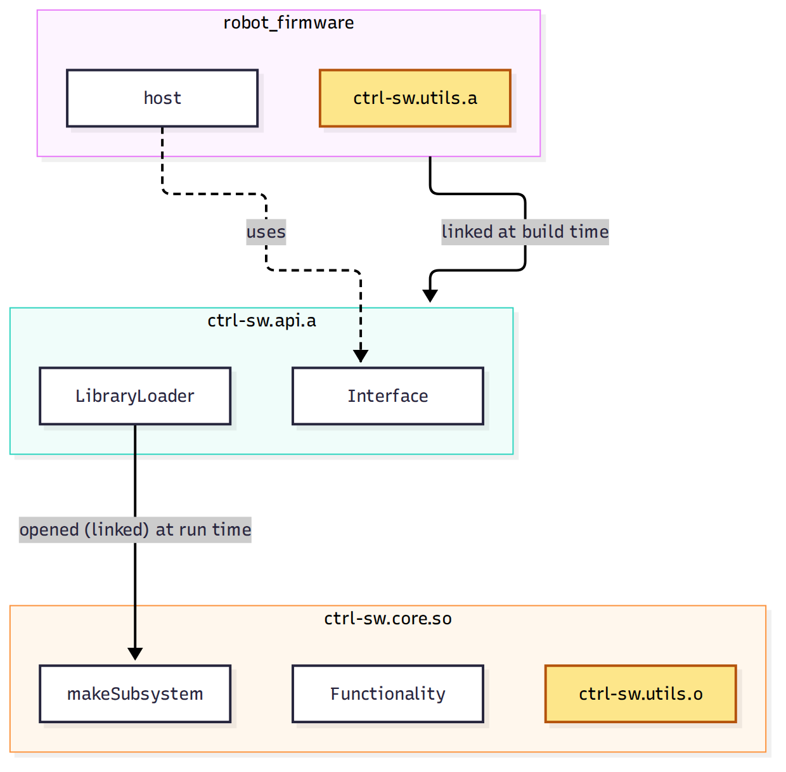

# Dealing with dynamic libraries in QNX and GNU/Linux

## Introduction

This note explains how static and dynamic libraries behave in QNX and other UNIX-like systems, and why some of those behaviors matter when a system is split into a statically linked part and a dynamically loaded part.

The discussion is driven by a real case: building **ctrl-sw**, the robot control software that runs inside our robot controllers, so that its core can be versioned and replaced independently of the application that uses it. While doing that, we ran into a few less obvious behaviors of dynamic libraries; this note collects what we learnt.

## What we are trying to achieve in ctrl-sw

ctrl-sw is split into two libraries:

- **`ctrl-sw.api.a`** (static) — the entry point of the application into the system. It is linked into the application at build time.
- **`ctrl-sw.core.so`** (dynamic) — the actual functionality. It is opened by `ctrl-sw.api.a` at run time, and the system is created by calling the `makeSubsystem` factory function exported by the library.

Because the core is only loaded at run time, a different version of `ctrl-sw.core.so` can be deployed with the same application, as long as the ABI between the two versions has not been broken.



Notice that the diagram contains **two copies of `ctrl-sw.utils`**:

- one linked as a static library (`ctrl-sw.utils.a`) into `robot_firmware`, and
- one embedded as object files (`ctrl-sw.utils.o`) inside `ctrl-sw.core.so`.

The core carries its own copy so that each version of `ctrl-sw.core.so` is self-contained and can be used through the same `ctrl-sw.api.a`, regardless of the `ctrl-sw.utils` version the firmware was built with. As shown below, this duplication is exactly what causes trouble if symbol visibility is not handled.

`ctrl-sw.api.a` and `ctrl-sw.core.so` contain other functionality as well, but it is out of the scope of this note.

## Library concepts

### Static vs. dynamic libraries

A library is a collection of pre-compiled code that can be reused by programs. There are two kinds: **static** and **dynamic**. In QNX and other UNIX-like systems dynamic libraries are called **shared objects** (`.so`).

Shared objects use the ELF format [[GUP]](#references) [[QNX]](#references), the standard file format for several kinds of binaries:

- executables and kernel images (`ET_EXEC`),
- shared objects (`.so`),
- relocatable object files produced by the compiler (`.o`, `ET_REL`),
- core dumps (`ET_CORE`).

A static library (`.a`) is *not* an ELF file itself: it is an archive of `.o` files, straight out of the compiler, exactly like the object files of the program. At link time the linker treats them the same way as the program's own objects — it pulls in the members that resolve undefined symbols and ignores the rest.

The main differences, adapted from [[DEH]](#references):

| Property | Static library | Dynamic library |
|---|---|---|
| When it is linked | At build time, as the last step; the needed code is copied into the executable. | At load time or run time, when the executable and its libraries are mapped into memory. |
| Who links it | The build-time linker (`ld`). | The operating system (its dynamic linker). |
| Size | Executables are bigger, since the library code is copied into each of them. | Executables are smaller; with PIC the library code is kept once in memory and shared between processes. |
| Changes in the library | The executable must be relinked to pick them up. | No relink needed, as long as the ABI is preserved. |
| Compatibility | No run-time compatibility issues: everything is inside the executable. | The program depends on a compatible library being present; it fails if the library is missing or incompatible. |
| Start-up time | No dynamic symbol resolution or relocation at start-up. | Some extra start-up cost for loading and relocation, partly offset when the library is already in memory for another process. |

A dynamic library can be used in two ways:

- **Load-time dynamic linking** — the library is linked to the executable at build time. It must be available when the application starts, and its symbols are resolved during start-up.
- **Run-time dynamic linking** — the application loads the library explicitly with `dlopen()` and looks up symbols with `dlsym()`. The application does not fail at start-up if the library is missing; it can detect and handle that itself.

ctrl-sw uses the second approach: `LibraryLoader` in `ctrl-sw.api.a` calls `dlopen()` on `ctrl-sw.core.so` and `dlsym()` to obtain `makeSubsystem`.

### Exporting all symbols from shared libraries

By default, QNX and other UNIX-like toolchains **export every global symbol** of a shared library (DSO). In ctrl-sw this is a problem, because there are two copies of `ctrl-sw.utils`: the symbols in `robot_firmware` and those in `ctrl-sw.core.so` have the same names and collide. See [[MHB]](#references).

There are two ways to deal with it:

1. **Link `robot_firmware` with `-E` (`--export-dynamic`).** The executable then exports its own symbols, and the references from `ctrl-sw.core.so` to `ctrl-sw.utils` are resolved against the copy in `robot_firmware`. The collision becomes deterministic, but the core no longer uses its own `ctrl-sw.utils`. This defeats the purpose of embedding it, and is unsafe if the two copies come from different versions.
2. **Restrict symbol visibility in `ctrl-sw.core.so`** [[GNU]](#references) [[LPB]](#references) [[ANA]](#references), so that only its public interface (`makeSubsystem` and friends) is exported. The embedded `ctrl-sw.utils.o` and all other internal symbols are no longer visible outside the library, so nothing can collide with them.

The second approach is the one that matches the design goal of a self-contained, replaceable core. [[MHB]](#references) discusses the differences between both approaches in detail.

Besides avoiding conflicts, hiding the symbols of a shared library has other benefits [[UD2011]](#references) [[GNU]](#references):

- much faster loading, since the dynamic linker has far fewer symbols to process,
- better code, since the optimizer knows that hidden symbols cannot be interposed,
- smaller libraries (typically 5–20 %),
- less chance of symbol conflicts with other libraries,
- internal (proprietary) details of the library are not exposed.

The visibility of the symbols can be inspected with `readelf`; the `Vis` column shows `HIDDEN` for hidden symbols, and `--dyn-syms` lists only what the library actually exports:

```bash
readelf -Ws libctrl-sw.core.so         # all symbols, with their visibility
readelf -W --dyn-syms libctrl-sw.core.so  # only the exported (dynamic) symbols
```

#### Visibility and static libraries

Visibility only takes effect when a **shared library or executable is linked**. Creating a static library does not involve the linker at all — `ar` just packs the object files — so nothing is hidden at that point.

However, the visibility attribute *is* recorded in each object file. It is ignored when the static library is linked into an executable, but it matters when the static library is linked into a shared library: the linker honors it, and every symbol that was compiled as hidden stays hidden. As a result, none of those symbols are reachable from outside the new shared library.

If you need to build a shared library on top of a static library compiled with hidden visibility, add **wrapper functions** with default visibility in the shared library that forward to the hidden code. The wrappers become the new public interface.

### Position-independent code in shared libraries

Code in a traditional (non-PIE) executable is position-dependent: it is tied to fixed addresses in memory. A shared library cannot work like that, because the linker cannot know where it will be loaded — each program can load any combination of libraries at different addresses.

ELF systems solve this in two ways:

- **Load-time relocation**
- **Position-independent code (PIC)**

With **load-time relocation**, the dynamic linker patches the addresses in the library's code when it is loaded. This costs time at every load and, more importantly, it modifies the text section (where the code lives). Since the text is patched differently in each process, it cannot be shared: every application that loads the library needs its own copy of it in RAM. That throws away one of the main reasons for having shared libraries in the first place — saving memory by mapping a single copy of common code into many processes.

**Position-independent code** is not tied to any particular address, so the same text section can be mapped at different addresses in different processes without changing a single bit. The idea is to add a level of indirection to all references to global data and functions. [[EBW]](#references) explains the mechanism in detail. PIC is the recommended way of building shared objects because it minimizes memory usage.

To get a PIC shared library, **every** object file in it must be compiled with `-fPIC`; this includes object files coming from static libraries that are linked into it. If a single object was not compiled as PIC, the library will need text relocations and will not be fully position-independent. A PIC library should therefore contain no `TEXTREL` entry in its dynamic section:

```bash
readelf -d lib.so | grep -i TEXTREL
```

On 32-bit x86, an object file compiled as PIC typically contains an unresolved reference to `_GLOBAL_OFFSET_TABLE_`, which is a quick (though architecture-dependent) way to check individual objects:

```bash
nm file.o | grep _GLOBAL_OFFSET_TABLE_
```

PIC is not free:

- **Extra indirection.** Every access to global data and every call to an external function goes through an extra level of indirection, i.e. an extra memory load per access. How much it costs in practice depends on the compiler, the CPU architecture and the application.
- **Register pressure.** To avoid locating the Global Offset Table (GOT) too often, the compiler keeps it in a register (usually `ebx` on 32-bit x86). This is no big deal on RISC architectures with many general-purpose registers, but can hurt on register-starved architectures such as 32-bit x86.

## Performance of static vs. dynamic libraries

When talking about performance we should distinguish:

- the time needed to **load** the library,
- the **execution** time of the library once it is loaded,

and, specific to our system, the time of the **initialization phase**, i.e. the first execution.

### Load time

A static library is part of the executable, so there is no separate loading step: its cost is part of loading the program, and it only affects start-up through the larger executable size.

A dynamic library linked at load time is mapped right after the program and its symbols are resolved and relocated during start-up, which adds some cost compared to a static library. On the other hand, if several programs use the same library, the ones that start later benefit from the library already being in memory — but only if the library is PIC, as explained above. A library opened with `dlopen()` pays the same cost, just at the moment it is opened instead of at start-up.

### Execution time once loaded

From a performance point of view, dynamic libraries have some drawbacks [[IBM]](#references):

- **Glue code.** Calls into a shared library go through indirection code. IBM estimates the cost at about 8 machine cycles per reference.
- **Worse locality of reference.** If you only use a few routines of a library, they may be scattered across its address space, so more pages must be touched than if those routines had been linked directly into the executable. This leads to more page faults and a higher chance of TLB misses.
- **More paging.** Each page of the library that contains a referenced routine has to be paged in individually. With static linking, several small routines from different pages of the library might end up together in a single page of the executable.

The first effect is practically imperceptible and hard to distinguish from normal measurement noise. The second and third do not apply to us: `ctrl-sw.core.so` is not a toolbox of loosely related functions but a complete system, and it is used as a whole.

In short, there are more effective places to look for performance than choosing between a static and a dynamic library. The choice of library type should come from **deployment requirements** (here: being able to replace the core independently), not from performance requirements.

### Initialization phase

Once the library is loaded, the system has to be initialized, and this is where most of the start-up time goes. The reason is a design decision, not the type of library.

The control-related subsystems of ctrl-sw allocate all the memory they need during initialization, because they must run in real time and dynamic memory allocation can break real-time guarantees. (The Interpreter, which is not real-time, allocates memory during execution.) It would also be possible to allocate memory in real time if an allocator with O(1) cost were used.

Consequently, **the system must be fully initialized before the host enters its real-time phase.**

This happens with both static and dynamic libraries, since it is a consequence of the design. It is not related to the size of the library either: size only affects the time needed to load and resolve the symbols.

## A note about libraries in Windows

Windows behaves the opposite way to QNX and other UNIX-like systems: by default a DLL exports **no** symbols.

When a DLL is built, a `.lib` file is generated alongside it. Despite having the same extension as a static library, it is not one: it is a special library used to link the DLL to the application.

Windows also offers **delay-loading** (`/DELAYLOAD` linker option). It works like load-time linking, except that the linker generates small stubs that, on the first call to a function, check whether the DLL is loaded and, if not, load it and resolve the function. This speeds up process start-up, but once resolved the calls perform the same as with normal load-time linking.

## References

- **[GNU]** Visibility in GCC. <https://gcc.gnu.org/wiki/Visibility> (Accessed: 2022-02-09)
- **[LPB]** GNU visibility attribute. <https://blog.the-pans.com/gnu-visibility-attribute> (Accessed: 2022-02-09)
- **[ANA]** Control over symbol exports in GCC. <https://anadoxin.org/blog/control-over-symbol-exports-in-gcc.html> (Accessed: 2022-02-09)
- **[MHB]** Shared library symbol conflicts (on Linux). <https://holtstrom.com/michael/blog/post/437/Shared-Library-Symbol-Conflicts-%28on-Linux%29.html> (Accessed: 2022-02-09)
- **[EBW]** Position Independent Code (PIC) in shared libraries. <https://eli.thegreenplace.net/2011/11/03/position-independent-code-pic-in-shared-libraries> (Accessed: 2022-02-11)
- **[DEH]** 10 differences between static and dynamic libraries every C++ developer should know. <https://www.acodersjourney.com/cplusplus-static-vs-dynamic-libraries> (Accessed: 2022-02-11)
- **[UD2011]** U. Drepper. How to write shared libraries. 2011. <https://www.researchgate.net/publication/240034378_How_To_Write_Shared_Libraries>
- **[IBM]** When to use dynamic linking and static linking. <https://www.ibm.com/docs/en/aix/7.2?topic=techniques-when-use-dynamic-linking-static-linking> (Accessed: 2022-02-11)
- **[GUP]** ELF loading and dynamic linking. <https://www.gabriel.urdhr.fr/2015/01/22/elf-linking> (Accessed: 2022-02-22)
- **[QNX]** How shared objects are used. <http://www.qnx.com/developers/docs/qnxcar2/index.jsp?topic=%2Fcom.qnx.doc.neutrino.sys_arch%2Ftopic%2Fdll_HOWUSED.html> (Accessed: 2022-02-22)
