# Portfolio photos

Captions and links of the photos in the home page slideshow.

- The slideshow shows the photos listed in this table, ordered by file name.
- **Photo**: the image file in this folder (the `` is only a preview for GitHub).
- **Caption**: short sentence shown under the photo. Leave it empty for no caption.
- **Link**: optional. A post of the scratchpad (`blog/YYYY/MM/DD/title.html`), a section of the projects page (`projects/#id`) or a full URL; it adds a "Read more →" link.
- Do not use `|` inside a cell.

| Photo | Caption | Link |
|---|---|---|
|  `01-1.jpg` | ABB robot in the Robotics Lab. of the DISA/UPV (2000–2004) | https://www.upv.es/entidades/disa/ |
|  `01-2.jpg` | Force sensor in the Robotics Lab. of the DISA/UPV (2000–2004) | |
|  `01-3.jpg` | Rhino XR-1 robot in the Robotics Lab. of the DISA/UPV (2000–2004) | |
| 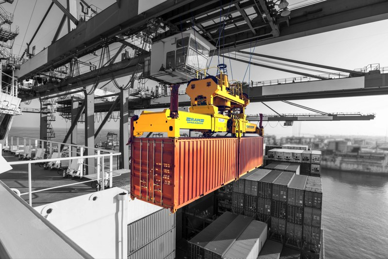 `02-1.jpg` | Container crane spreader (2001). Illustrative photo: Joe.Sa1998, CC BY-SA 4.0 | projects/#container-help |
| 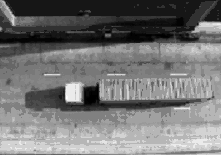 `02-2.png` | Container seen by the camera of the crane vision system (2001) |  |
|  `03-1.jpg` | Cardboard aligner with visual feedback for Smurfit (2001) | https://www.smurfitwestrock.com/ |
| 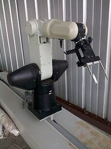 `04-1.jpg` | CRS robot arm used in my final degree project, a distributed 3D vision system (2002) | https://www.researchgate.net/publication/258175171_A_distributed_3D_vision_system |
|  `04-2.jpg` | Joints of the 6-axis CRS robot arm (2002) | |
|  `05-1.png` | Robotic cell for manufacturing Trencadís mosaics (2002) | https://www.researchgate.net/publication/229151042_Intelligent_robotic_cell_for_Trencadspl_inodotspl_acutes_mosaics_manufacturing |
| 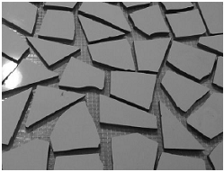 `06-1.png` | Tiles arranged by the Trencadís robotic cell (2003) | projects/#trencadis |
|  `07-1.png` | Follower and leader mobile robots simulated in VRS (2003) | projects/#follower |
|  `07-2.png` | Sensor system of the follower robot (2003) | |
| 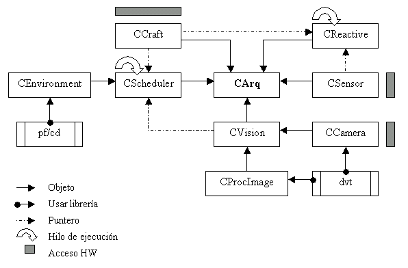 `07-3.png` | Hybrid control architecture of the follower robot (2003) |  |
| 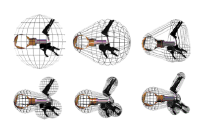 `08-1.png` | Collision detection using Minkowski spaces for Virtual Robot Simulator (2003) | projects/#acdlib |
| 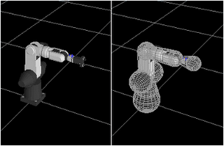 `08-2.png` | Robot arm model in the Minkowski-space collision detection library (2003) |  |
| 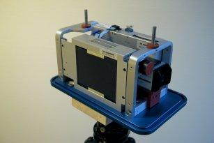 `09-1.png` | ALIS, an autonomous surveillance unit integrated with the RADAR monitoring system (2006) | projects/#alis |
| 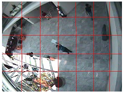 `09-2.png` | A community of software agents for event detection in images (2004–2006) | projects/#agents |
| 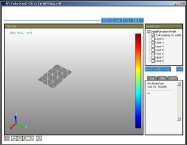 `09-3.png` | RadarDEM, a 3D viewer to assess avalanche paths extracted from radar images (2006) | projects/#radardem |
| 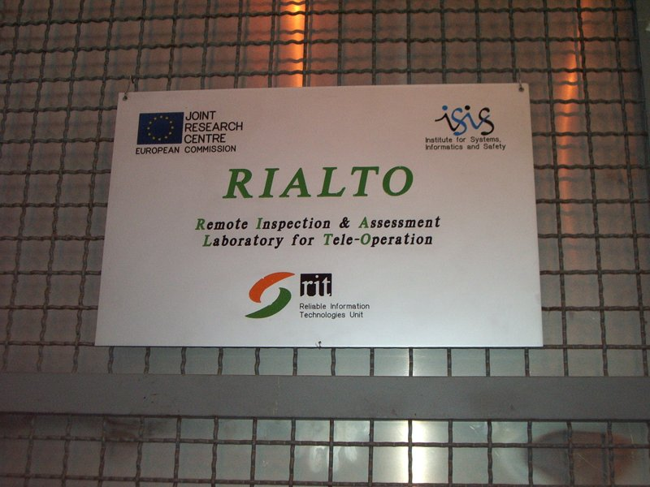 `10-1.jpg` | RIALTO, Remote Inspection & Assessment Laboratory for Tele-Operation at the EC JRC (2007–2009) |  |
| 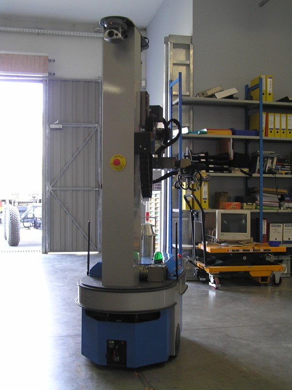 `11-1.jpg` | Robstar, a mobile manipulator for the EU JRC (2007) | projects/#robstar |
|  `11-2.jpg` | Robstar with a container on its transport pad (2007) | projects/#robstar |
|  `11-3.jpg` | Robstar end-effector with camera and force/torque sensor (2007) |  |
| 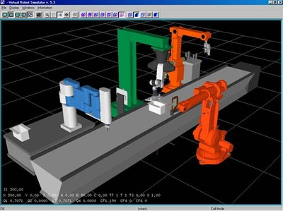 `11-4.jpg` | Virtual Robot Simulator as a GUI component for Robstar (2007–2008) | projects/#vrs |
|  `12-1.jpg` | Security mobile robot developed for MoviRobotics (2008) | projects/#movirobotics |
|  `12-2.jpg` | Prototypes of the MoviRobotics security mobile robot (2008) |  |
|  `13-1.jpg` | Motion Control Engine of NJ (2009) | projects/#mce |
| 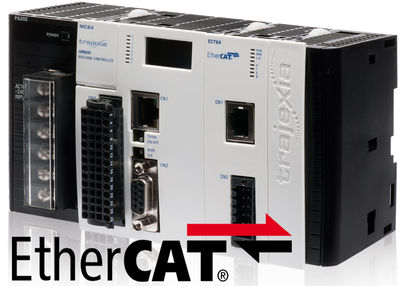 `14-1.jpg` | OMRON Trajexia motion controller (2010–2011) | projects/#trajexia |
|  `15-1.png` | Kinematic diagram of a delta-3 robot (2011) | blog/2011/09/16/kinematics-delta-3-robot.html |
| 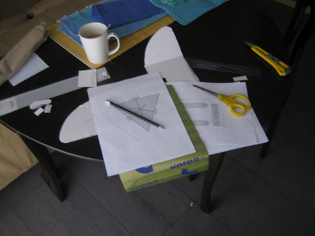 `15-2.jpg` | Building a cardboard model of a delta-3 robot (2011) | blog/2010/09/25/studying-delta-3-robot.html |
| 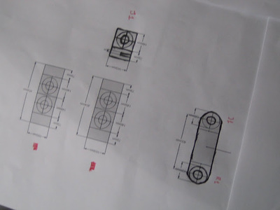 `15-3.jpg` | Drawings of the links of a cardboard delta-3 robot (2011) | |
|  `15-4.png` | Workspace of a delta-3 robot computed in Scilab (2011) | |
|  `16-1.jpg` | Delta-3 robot (2011) | projects/#nj-robotics |
| 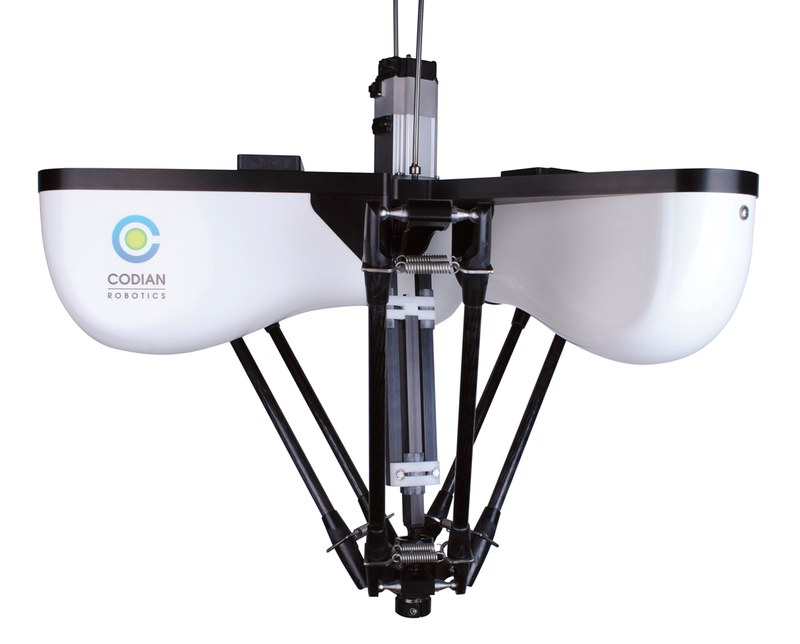 `16-2.jpg` | Delta-3 robot, detail of the parallel arms (2011) |  |
| 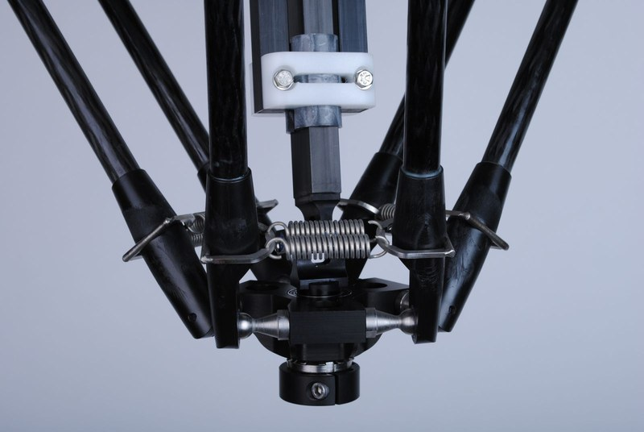 `16-3.jpg` | Delta-3 robot joint (2011) |  |
| 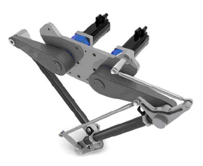 `17-1.png` | CAD model of a delta-2 robot (2012)| blog/2012/06/02/kinematics-delta-2-robot.html |
|  `17-2.png` | Delta-2 robot geometry: links and end-effector (2012) | |
|  `17-3.png` | Workspace of a delta-2 robot (2012) | |
|  `18-1.jpg` | “Cat and mouse” game with ROS, MORSE and a CRAM plan (2013) | blog/2013/01/26/cat-and-mouse-in-ros-morse-and-cram.html |
| 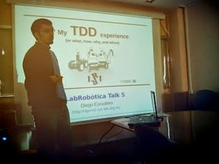 `19-1.jpg` | Talk about my TDD experience at IRI (2014) | blog/2014/04/24/talk-tdd-IRI.html |
|  `20-1.png` | Flexible machines with robotics and vision, talk at ISOLA (2014) | blog/2014/10/12/talk-isola-2014.html |
|  `21-1.jpg` | KUKA LWR simulated in MORSE and controlled with ROS and MoveIt (2014) | blog/2014/06/10/control-klwr-using-morse-and-ros.html |
|  `22-1.jpg` | Application in C++, Qt and OpenGL to simulate a RU link (2014) | blog/2014/07/01/app-simulate-RU-link.html |
| 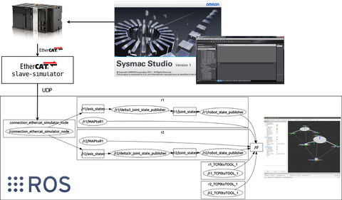 `23-1.png` | Architecture of the visualizer: OMRON NJ, EtherCAT slave simulator and ROS (2015) | blog/2015/04/19/robot-visualizer-using-ros-and-ecat.html |
|  `23-2.png` | Visualizer of delta robots done with ROS and EtherCAT (2015) | |
|  `23-3.png` | Real delta robot next to its ROS visualizer (2015) | |
| 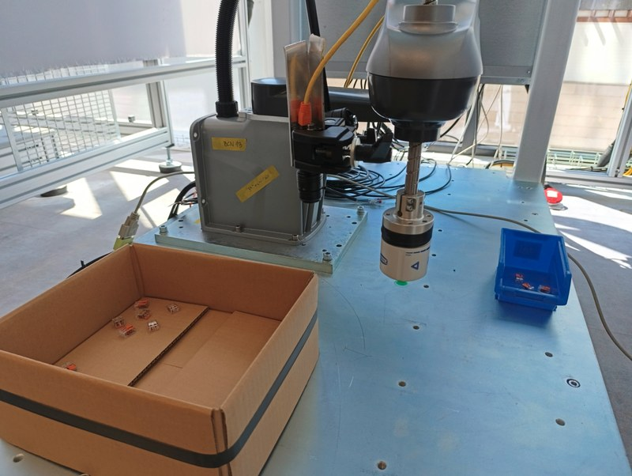 `24-1.jpg` | Robot with a wrist camera executing behavior trees learned in my PhD thesis (2025) | projects/#phd |
| 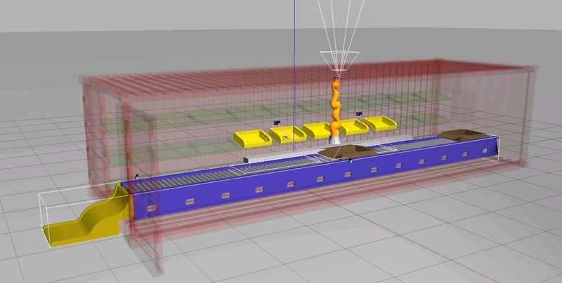 `24-2.jpg` | Simulated kitting environment based on ARIAC 2018, used to learn robot actions (2025) | |
| 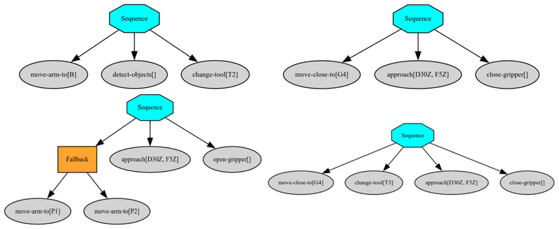 `24-3.png` | Behavior trees learned with genetic programming for pick and place tasks (2025) | |
