# Portfolio photos

Captions and links of the photos in the home page slideshow.

- The slideshow shows the photos listed in this table, ordered by file name.
- **Photo**: the image file in this folder (the `` is only a preview for GitHub).
- **Caption**: short sentence shown under the photo. Leave it empty for no caption.
- **Link**: optional. A post of the scratchpad (`blog/YYYY/MM/DD/title.html`) or a full URL; it adds a "Read more →" link.
- Do not use `|` inside a cell.

| Photo | Caption | Link |
|---|---|---|
| 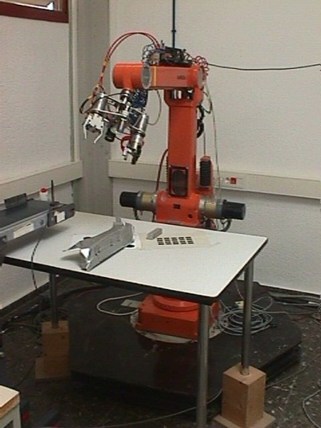 `01-1.jpg` | ABB robot in the Robotics Lab. of the DISA/UPV (2000) | https://www.upv.es/entidades/disa/ |
| 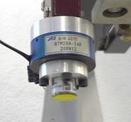 `01-2.jpg` | Force sensor in the Robotics Lab. of the DISA/UPV (2000) | |
| 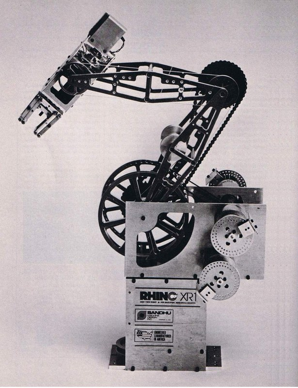 `01-3.jpg` | Rhino XR-1 robot in the Robotics Lab. of the DISA/UPV (2000) | |
|  `02.jpg` | Cardboard aligner with visual feedback for Smurfit (2001) | https://www.smurfitwestrock.com/ |
| 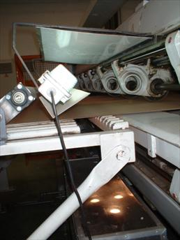 `03-1.jpg` | CRS robot arm used in my final degree project, a distributed 3D vision system (2002) | https://www.researchgate.net/publication/258175171_A_distributed_3D_vision_system |
| 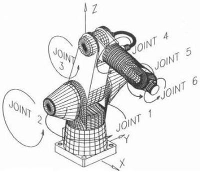 `03-2.jpg` | Joints of the 6-axis CRS robot arm (2002) | |
| 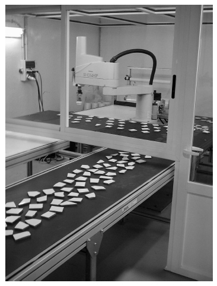 `04.png` | Robotic cell for manufacturing Trencadís mosaics (2002) | https://www.researchgate.net/publication/229151042_Intelligent_robotic_cell_for_Trencadspl_inodotspl_acutes_mosaics_manufacturing |
|  `05-1.png` | Follower and leader mobile robots simulated in VRS (2003) | |
| 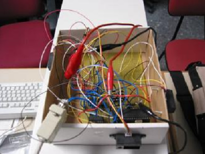 `05-2.png` | Sensor system of the follower robot (2003) | |
|  `06.jpg` | Simulation of a robotic work cell using Virtual Robot Simulator (2004) |  |
| 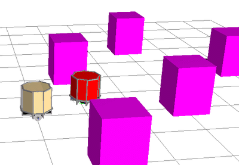 `07-1.png` | Collision detection using Minkowski spaces for Virtual Robot Simulator (2004) |  |
|  `07-2.png` | Robot arm model in the Minkowski-space collision detection library (2004) |  |
|  `08-1.jpg` | Robstar, a mobile manipulator for the EU JRC (2007) |  |
| 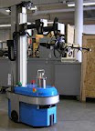 `08-2.jpg` | Robstar mobile manipulator with two arms (2007) |  |
| 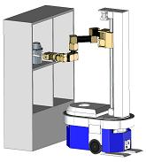 `08-3.jpg` | CAD design of the Robstar mobile manipulator (2007) |  |
| 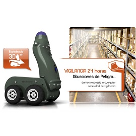 `09-1.jpg` | Security mobile robot developed for MoviRobotics (2009) |  |
| 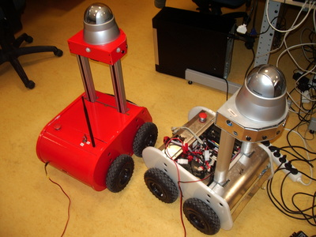 `09-2.jpg` | Prototypes of the MoviRobotics security mobile robot (2009) |  |
|  `10.jpg` | OMRON Trajexia motion controller (2009) | |
| 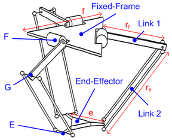 `11-1.png` | Kinematic diagram of a delta-3 robot (2011) | blog/2011/09/16/kinematics-delta-3-robot.html |
| 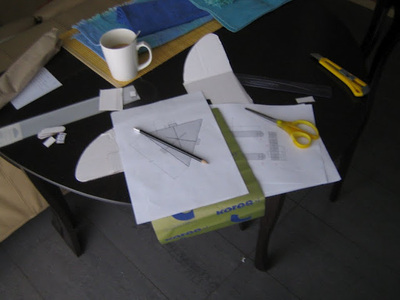 `11-2.jpg` | Building a cardboard model of a delta-3 robot (2011) | blog/2010/09/25/studying-delta-3-robot.html |
| 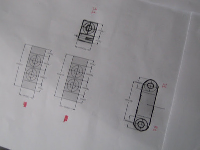 `11-3.jpg` | Drawings of the links of a cardboard delta-3 robot (2011) | |
| 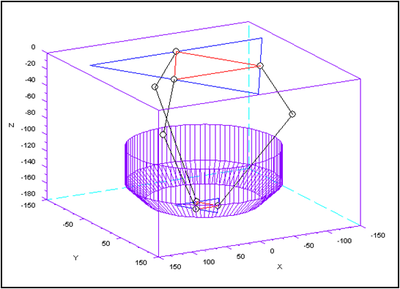 `11-4.png` | Workspace of a delta-3 robot computed in Scilab (2011) | |
|  `12-1.jpg` | OMRON NJ-Robotics controller (2011) |  |
|  `12-2.jpg` | Delta-3 robot (2011) |  |
|  `12-3.jpg` | Delta-3 robot, detail of the parallel arms (2011) |  |
| 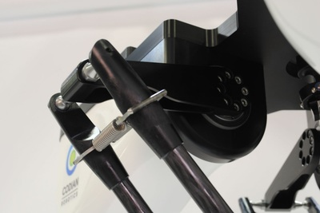 `12-4.jpg` | Delta-3 robot joint (2011) |  |
| 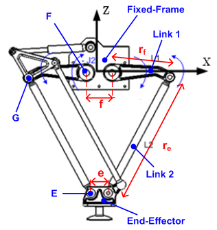 `13-1.png` | CAD model of a delta-2 robot (2012)| blog/2012/06/02/kinematics-delta-2-robot.html |
|  `13-2.png` | Delta-2 robot geometry: links and end-effector (2012) | |
| 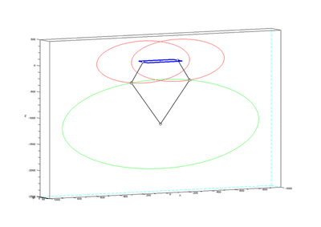 `13-3.png` | |
| 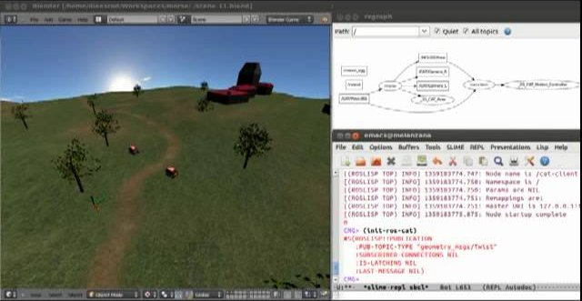 `14.jpg` | “Cat and mouse” game with ROS, MORSE and a CRAM plan (2013) | blog/2013/01/26/cat-and-mouse-in-ros-morse-and-cram.html |
| 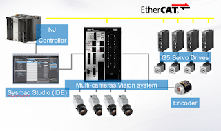 `15.png` | Flexible machines with robotics and vision, talk at ISOLA (2014) | blog/2014/10/12/talk-isola-2014.html |
| 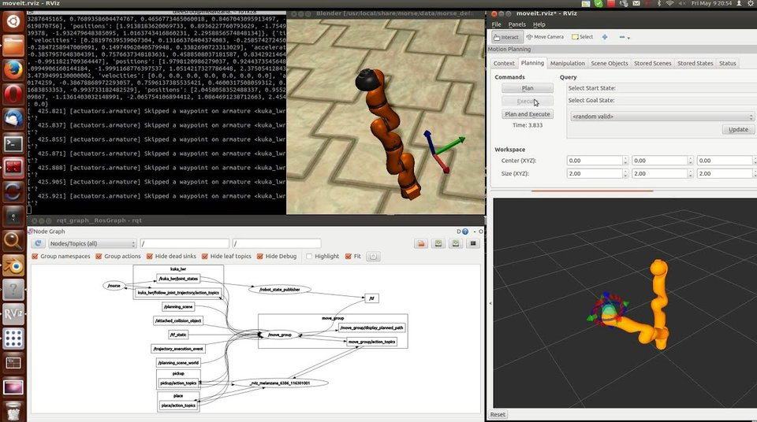 `16.jpg` | KUKA LWR simulated in MORSE and controlled with ROS and MoveIt (2014) | blog/2014/06/10/control-klwr-using-morse-and-ros.html |
| 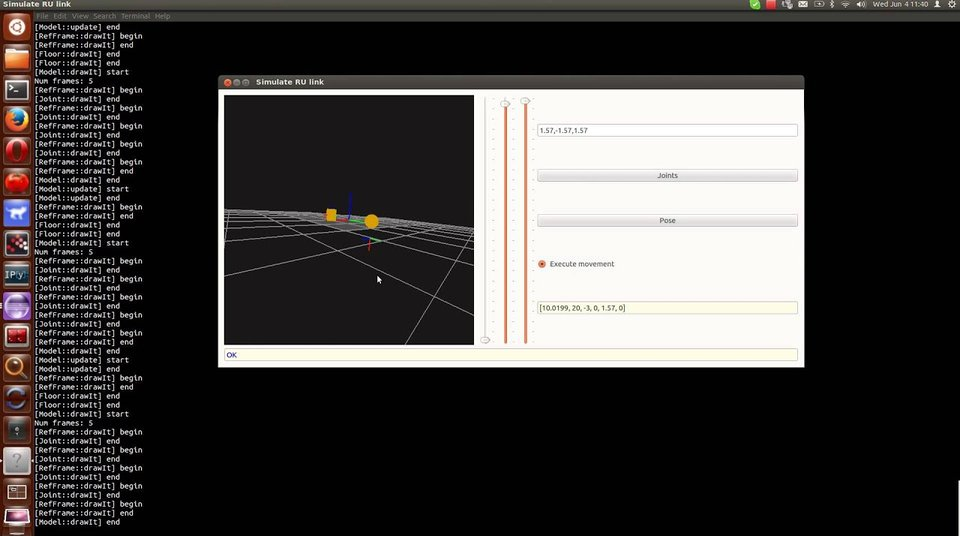 `17.jpg` | Application in C++, Qt and OpenGL to simulate a RU link (2014) | blog/2014/07/01/app-simulate-RU-link.html |
|  `18-1.png` | Architecture of the visualizer: OMRON NJ, EtherCAT slave simulator and ROS (2015) | blog/2015/04/19/robot-visualizer-using-ros-and-ecat.html |
| 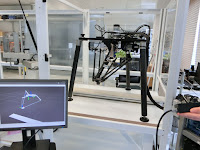 `18-2.png` | Visualizer of delta robots done with ROS and EtherCAT (2015) | |
| 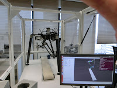 `18-3.png` | Real delta robot next to its ROS visualizer (2015) | |
